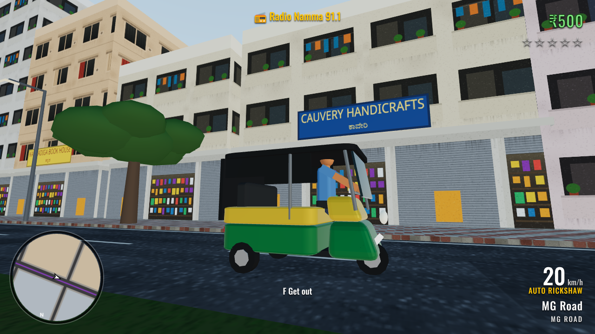

# Namma Bengaluru

An open-world, GTA-style game set in central Bengaluru, built for the browser with [Three.js](https://threejs.org).
No downloads and no asset packs: the city, vehicles, people, textures and sound are all generated in code.



## Play it

```bash
npm install
npm run dev        # open the printed URL (default http://localhost:5173)
```

`npm run build` writes a static site to `dist/` that can be hosted anywhere (GitHub Pages, Netlify, etc.).

### Controls

| Key | Action |
| --- | --- |
| W A S D / arrows | Walk / drive |
| Mouse | Look around (click the game to capture the mouse) |
| Shift | Run |
| Space | Jump / handbrake |
| F (or E) | Get in or out of a vehicle. Works on traffic too ("borrowing") |
| H (or Q) | Horn |
| J | Accept the gig on your phone |
| M | City map |
| R | Radio on/off |
| Esc | Pause |

## What's in Milestone 1 (drivable sandbox)

- **A stylised central Bengaluru**, about 1 km², laid out on real street names: MG Road, Brigade Road, Church Street,
  Residency Road, Kasturba Road, Queens Road, Cubbon Road, Commercial Street and more.
- **Landmarks:** Vidhana Soudha (with *ಸರ್ಕಾರದ ಕೆಲಸ ದೇವರ ಕೆಲಸ* over the portico), Attara Kacheri (High Court), Cubbon Park
  with the State Central Library, bandstand and Queen Victoria statue, Chinnaswamy Stadium, St. Mark's Cathedral,
  Ulsoor Lake, a UB City-style sky tower, and the **Namma Metro Purple Line** above MG Road with a working station and trains.
- **Vehicles:** auto rickshaws (green and yellow, fare meter included), Activa-style scooters, hatchbacks, city cabs
  (yellow plates), SUVs and BMTC buses (Vajra blue, classic red, green). Arcade handling with drift on the handbrake,
  two-wheeler lean and right-hand drive (you exit on the right).
- **Traffic** that keeps left, follows the road graph, stops for obstacles and honks constantly. When it's stuck long
  enough it squeezes through anyway.
- **Street life:** pedestrians in shirts, kurtas, sarees and lungis on the footpaths, chai stalls, and cows that wander
  the roads and that traffic must respect.
- **Look:** physical sky with image-based lighting, late-afternoon sun with soft shadows, haze, grimy facades with
  chajjas, split ACs, balconies with drying clothes, black Sintex tanks on every roof, rain trees and gulmohars, and
  shop signs in English and Kannada.
- **Gigs:** food delivery runs (Masala Dosa from Sri Sagar Darshini to Richmond Town in under 90 seconds), or auto
  fares when you're driving an auto. Timed, paid in ₹, with tips and a star rating.
- **GTA basics:** district name toasts, a rotating minimap, full map, speedometer, a wanted level (theft and reckless
  driving), and a synthesised engine, horns, ambience and radio.

## Code tour

```
src/
  config.js            Map definition: roads, zoning, districts, shop signs, dialogue
  main.js              Renderer, sky and lighting, game loop, vehicle-vehicle collisions
  world/
    layout.js          Derived blocks, traffic graph, spatial queries (roadAt, blockAt, groundHeight)
    city.js            Builds roads, footpaths, buildings, trees, lamps from the layout
    landmarks.js       Procedural landmark models
    metro.js           Purple Line viaduct, station and trains
    textures.js        Canvas-painted textures (facades, asphalt, pavers, signs, water normals)
    meshBuilder.js     Merges thousands of boxes into a few chunked draw calls
  entities/
    vehicleModels.js   Vehicle specs and procedural models
    vehicle.js         Arcade vehicle physics
    traffic.js         AI drivers following the road graph
    pedestrians.js     Footpath walkers, chai stalls, cows
    human.js           Procedural people + walk/sit animations
    player.js          On-foot controller, entering/exiting/carjacking
  systems/             Input, camera rig, colliders, audio, missions + wanted level
  ui/hud.js            Minimap, toasts, speedometer, phone, map
```

Every model is built from code, so swapping in real art later is local: replace a `build*` function in
`vehicleModels.js` / `landmarks.js` / `human.js` with a glTF loader and the rest of the game won't notice.

## Roadmap (let's decide the order together)

1. **Police & chases:** Hoysala patrol cars that respond to the wanted level, roadblocks, getting busted.
2. **Story missions:** a first chapter, e.g. a newcomer hustling through gigs who gets pulled into a real-estate
   mafia's land grab. Cutscenes and a character cast.
3. **Day/night cycle and monsoon rain:** streetlights, lit signs, flooded underpasses, wet roads.
4. **Bigger map:** Koramangala, Indiranagar 100 Feet Road, Silk Board junction (the boss level), Majestic bus stand,
   KR Market, ORR tech parks, flyovers.
5. **Real art pass:** glTF models for hero vehicles, characters and landmarks; skinned, animated characters.
6. **More Bengaluru:** traffic police at junctions, signals, potholes and speed breakers, BMTC bus routes you can
   ride, Namma Metro you can board, Kannada/Hinglish voice lines, a proper radio with stations.
7. **Mobile/touch controls** and performance settings.
