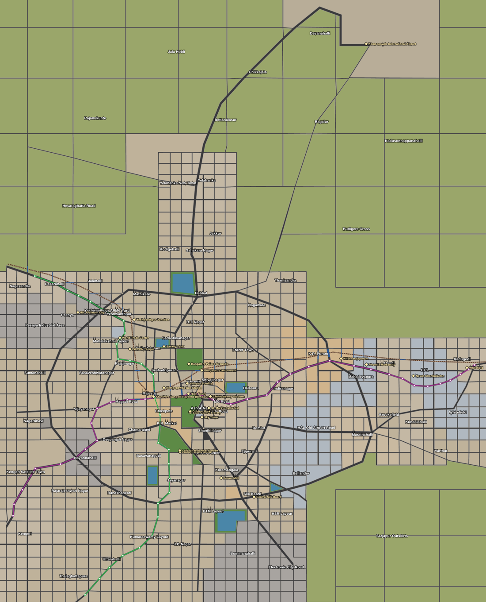
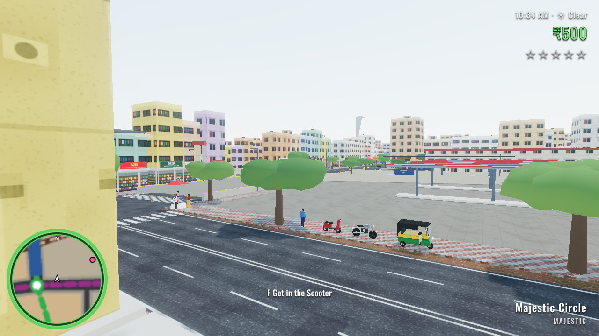
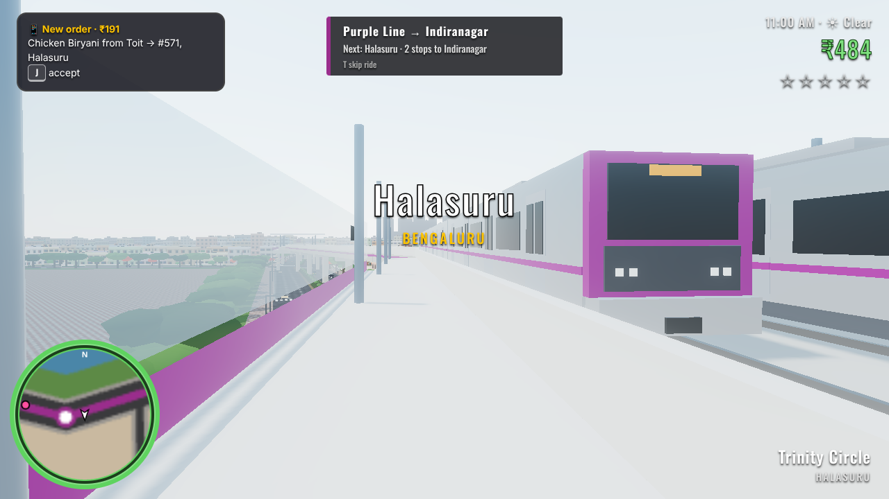
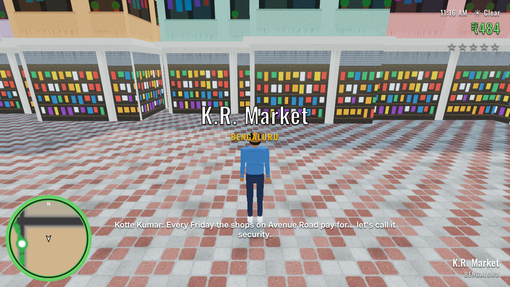
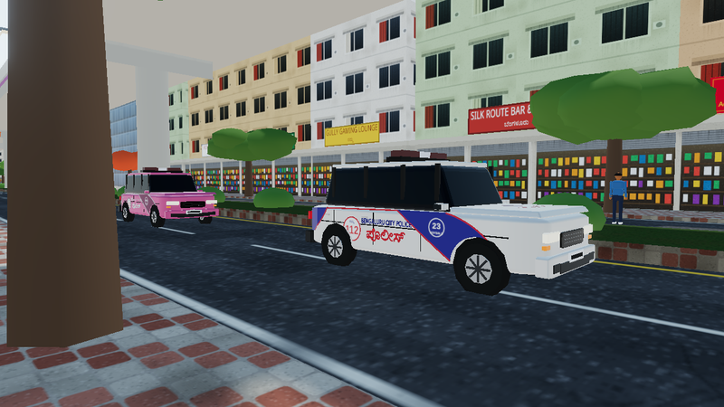
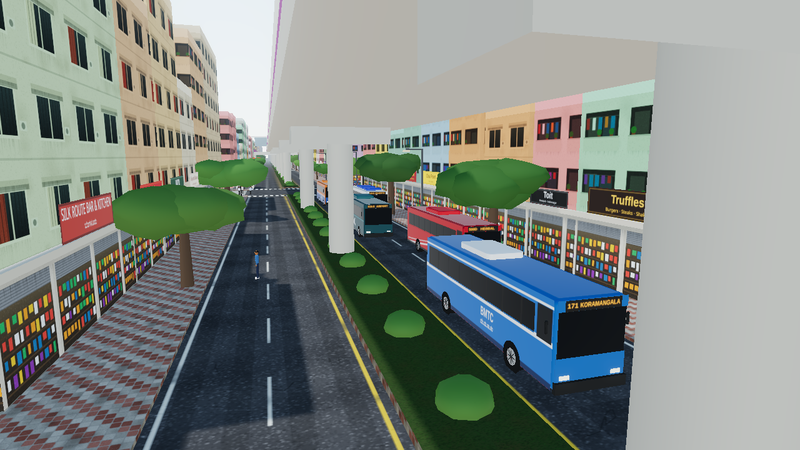
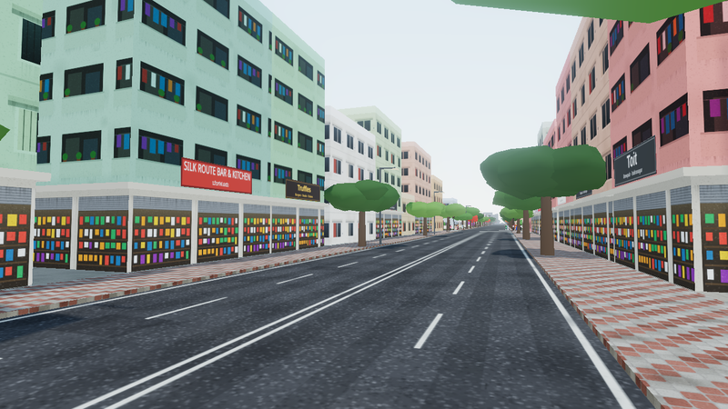

# Namma Bengaluru

An open-world, GTA-style game set in Bengaluru, built for the browser with [Three.js](https://threejs.org).
No downloads and no asset packs: the city, vehicles, people, textures and sound are all generated in code.



| | |
| --- | --- |
|  |  |
| You start at Majestic, by the Kempegowda Bus Station | Riding the Purple Line: the train pulls into Halasuru |
|  |  |
| Act I: Kotte Kumar explains "security" in Chickpete | Hoysala patrol cars in the Bengaluru City Police livery |
|  |  |
| BMTC Ordinary, Vayu Vajra and Vajra buses | Real Bengaluru brands: Truffles, Toit and more |

## Play it

```bash
npm install
npm run dev        # open the printed URL (default http://localhost:5173)
```

`npm run build` writes a static site to `dist/` that can be hosted anywhere (GitHub Pages, Netlify, etc.).
On slower machines open **Settings** on the pause screen (quality presets, resolution, shadows, draw distance,
traffic density) or press **O** for the Low preset.

**Phones and tablets** get touch controls automatically: a joystick on the left for walking and steering, drag on
the right to look, and buttons that change between on foot and driving.

### Controls

| Key | Action |
| --- | --- |
| W A S D / arrows | Walk / drive |
| Mouse | Look around (click the game to capture the mouse) |
| Shift | Run |
| Space | Jump / handbrake |
| Left mouse / Z | Punch, swing or fire |
| Right mouse | Kick, or aim when holding a gun |
| X | Kick |
| Tab / 1-9 | Switch weapon |
| C | Look behind while driving |
| F (or E) | Get in or out of a vehicle. Works on traffic too ("borrowing") |
| H (or Q) | Horn (every vehicle type sounds different) |
| G | Siren, when you're driving a Hoysala |
| E | At a metro station entrance: buy a token and ride |
| J | Accept the gig on your phone |
| M | City map |
| R | Radio on/off |
| K | Summon (or stop) the monsoon |
| T | Fast-forward time ×30; on the metro, skip the wait or the ride |
| O | Quick switch to the Low graphics preset |
| Esc | Pause |

## What's in the game

### The map: real Bengaluru

- It's built from **real geography** at 1/5 scale around Majestic: about 6.3 km × 7.8 km of game world,
  from Kengeri in the south-west to **Whitefield** in the east and **Kempegowda International Airport**
  in the north.
- The city proper gets a dense street grid. Yelahanka, Whitefield and K.R. Puram are built up too,
  and the countryside in between has fields, farmhouses and village roads.
- **About 36 arterials** follow their real alignments: Tumkur Road, Mysore Road, Bellary Road,
  Hosur Road, Old Madras Road, the whole Outer Ring Road loop, MG Road, Chord Road, the **airport
  road (NH 44)**, the Hennur–Bagalur road, ITPL Main Road, Whitefield Main Road and more.
  A street grid fills the neighbourhoods between them.
- Blocks are real polygons, and buildings sit on lots that face their road.
- About **60 neighbourhoods**, each with its own character: markets in Chickpete and K.R. Market,
  towers in Ashok Nagar, factories in Peenya, pubs in Indiranagar and Koramangala.
- **Parks and lakes** are where they should be: Cubbon Park, Lalbagh, the Palace Grounds,
  Bangalore University, and Ulsoor, Sankey, Hebbal, Madiwala, Agara and Yediyur lakes.
- **Landmarks** sit at their real locations: Vidhana Soudha, the High Court, Chinnaswamy Stadium,
  St. Mark's Cathedral, ISKCON, WTC at Brigade Gateway, IBC Platinum City, the Forum, Central Silk
  Board, the Lalbagh Glass House, the State Central Library, the **Kempegowda Bus Station**
  at Majestic, **ITPL** in Whitefield, and the **airport** with both terminals, the control tower,
  parked jets and departures taking off every minute and a half.
- **Flyovers.** The Silk Board and Hebbal flyovers carry the inner lanes over the junction. The
  Hebbal one follows Bellary Road round the bend.
- **Underpasses.** Underpasses run wherever a road crosses the railway, plus the K.R. Circle and
  Okalipuram underpasses. They flood in the monsoon.
- **Railway.** Indian Railways lines run from KSR Bengaluru City to Yeshwanthpur, and via
  Cantonment and K.R. Puram to Whitefield. Five stations; trains follow the curves. At level
  crossings the booms come down when a train is near and traffic queues behind them.
- **Signals.** About 35 signalised junctions where arterials meet. Approaches are grouped by
  direction, with an all-red pedestrian phase. Traffic constables stand at the named junctions.

### Namma Metro

- The **Purple Line** (Kengeri to Whitefield (Kadugodi), including the Whitefield extension) and
  the **Green Line** (Nagasandra to Silk Institute) run through their real stations.
- The lines are elevated over the arterials and go underground through the centre: Majestic,
  Cubbon Park, Chickpete and K.R. Market.
- **Riding:**
  - Walk up to a station entrance and press **E**.
  - Pick a destination. The fare depends on the number of stops, and the trip changes at Majestic
    if needed (the two lines' halls are on different levels).
  - Wait on the platform for a real train going your way, then ride it.
  - **T** skips the wait or the ride.

### Vehicles and driving

- **Tyre physics.** Driving uses a bicycle model with slip angles, load transfer and handbrake
  turns, plus a stability assist that keeps it fun. Two-wheelers lean.
- **Real car models**, each with its own proportions:
  - Maruti Alto, WagonR, Swift and Dzire
  - Hyundai i10, Verna and Creta
  - Toyota Etios and Innova
  - Honda City, Maruti Ertiga, Tata Nexon, Mahindra Scorpio and Bolero
- **Taxis** are Etios, Dzire, Innova and Ertiga. The **Hoysala** is a Maruti Ertiga in the current
  Bengaluru City Police livery. There's also a Pink Hoysala.
- **More types:** scooters, a Royal Bullet, autos, goods autos, and **BMTC buses** in five real
  liveries with LED route boards. Tempo travellers, mini trucks, lorries ("Horn OK Please"), water
  tankers and school buses round it out.
- **Damage:**
  - Crashes dent the body, and the engine smokes as it weakens.
  - Past a point the engine dies and the vehicle won't move.
  - Keep hitting it and it catches fire, explodes, and leaves a scorched wreck.

### Garages and your own vehicles

- Puncture-and-service stalls all over town, and **Chikka Motors** in Gandhinagar.
- Drive into the blue bay to **repair** the damage or **respray**. A new colour clears a wanted
  level of up to 3 stars, as long as no Hoysala saw you drive in.
- Chikka Motors **sells vehicles**: an Activa, a Bullet, an auto and real car models up to a Scorpio.
  What you buy is saved, waits outside Chikka Motors when you load, and can be brought to any garage.

### Traffic, people and police

- **Traffic.**
  - About 170 vehicles are streamed around you, rising 1.3× at rush hour. Lorries come out at night.
  - Cars and buses keep their lanes.
  - Autos and two-wheelers weave, squeeze through gaps and sometimes ride against the traffic.
- **People.** Footpath walkers, crowds at signals that cross on the walk phase (or jaywalk),
  chai stalls and cows.
- **Weapons**, grounded in the region:
  - **Melee:** fists, a lathi, a cricket bat, a chain, a knife (chaaku), a sickle (kudugolu) and
    a machete ("long").
  - **Guns are rare:** a country-made **katta** that sometimes misfires, and a revolver.
- **Rowdies.** Gangs of rowdies hang around markets and yards after dark.
- **Police.**
  - A wanted level from 1 to 5 stars.
  - Hoysalas route through the streets and ram you, and constables come at you with lathis.
  - Armed officers appear at 3 stars or more.
  - Get **BUSTED** or **WASTED**, and pay the bill.

### Day/night and monsoon

- **Day/night.** A 24-minute day brings lit windows, sodium street-lamp pools, headlights and bloom.
- **Monsoon.** Rain showers come on their own, with lightning, wet roads and flooded underpasses.
  Traffic slows down and wades through; drive into the deep end and your engine can drown.

### Brands

- **Shops.** 26 real Bengaluru names, many in their home neighbourhoods: A2B, MTR, Vidyarthi
  Bhavan, CTR, Meghana Foods, Truffles, Toit, Café Coffee Day and more.
- **Fuel stations.** HP, Indian Oil and Bharat Petroleum forecourts.
- **Hotels and malls.** The JW Marriott, ITC Gardenia, Taj MG Road, Orion Mall and Mantri Square.

### Story and gigs

- **Story** ([docs/STORY.md](docs/STORY.md)). Raghu, a delivery rider from the coast, rises through
  the Majestic underworld. The full arc runs through rise, empire, exile in Dubai and a
  "reformed" return.
  - **Act I is playable:** five missions, from a parcel run for the market rowdy Kotte Kumar to
    the ambush on Magadi Road.
  - Mission givers are pink markers on the map.
  - Progress and money are **saved** in the browser.
- **Gigs.** Food deliveries and auto fares keep the money coming between missions.

See **[docs/GAME_OUTLINE.md](docs/GAME_OUTLINE.md)** for the game outline: pillars, map, core loop, systems,
art direction and what's next.

## Code tour

```
src/
  config.js            Constants, shop signage and brands, dialogue lines
  main.js              Renderer + bloom, game loop, busted/wasted, vehicle-vehicle collisions
  world/
    mapdata.js         Real geography: arterials, metro stations, railway, parks, lakes, districts, landmarks
    roadnet.js         Polylines → planar road graph → polygon city blocks (pure JS, testable in Node)
    layout.js          Junction corners and cut-backs, traffic edges, blocks, underpasses, flyovers, queries
    city.js            Kerbed footpaths, lots in rotated frames, buildings, parks, lakes, trees, lamps
    infrastructure.js  Carriageways, junction pads, zebras, medians, underpasses + flood water, flyovers
    railway.js         Indian Railways lines, level crossings, stations, trains on curves
    metro.js           Namma Metro routes, viaducts, stations (elevated and underground), trains
    landmarks.js       Procedural landmark models
    geom.js, path.js   Polygon fill/walls, rectangle overlap, arc-length polylines
    textures.js        Canvas-painted textures (facades, lit windows, asphalt, pavers, signs, water)
    meshBuilder.js     Merged/chunked geometry with local frames, per-vertex PBR material, rigid skinning
  entities/
    human.js           Skinned 13-bone people + animations
    carBodies.js       Lofted car bodies for the real models (Swift, Dzire, Etios, Innova…)
    vehicleModels.js   Vehicle types as single skinned meshes (wheels are bones), decals
    liveries.js        One canvas atlas for every livery: Hoysala, BMTC, LED boards
    vehicle.js         Tyre-model physics, damage, fire, flood drag and stalling
    traffic.js         Streaming AI traffic on the road graph
    pedestrians.js     Footpath walkers, signal crowds, chai stalls, cows, reactions
    gangs.js           Rowdies and mission crews
    player.js          On foot, weapons, swimming, vehicles
  systems/
    story.js           Story missions (step scripts), mission givers, saving
    metroRide.js       Tokens, platforms, riding, interchange, skipping
    police.js          Wanted level, Hoysala pursuit AI, constables, busting
    weapons.js         Weapon table, raycasts, pickups
    signals.js         Signal phases by approach, heads, traffic constables
    environment.js     Day/night, sky, rain, lightning, wetness, flooding, headlights
    audio.js           Synthesised engines, horns, siren, gunshots, rain, thunder
    missions.js        Gigs; also cameraRig.js, colliders.js (incl. oriented boxes), particles.js, input.js
  ui/hud.js            Minimap, health ring, wanted stars, clock/weather, map, mission panel
```

`window.__game.step(n)` advances the simulation without rendering, which is how the automated checks drive the game.

## Roadmap

The full list is in [docs/GAME_OUTLINE.md](docs/GAME_OUTLINE.md#next-up-proposed). Highlights: Act II (land deals,
a war with Seenu, ACP Shalini Rao), garages and repairs, a phone UI, police roadblocks and Cheetah bikes, the
airport road and Whitefield, and a glTF art pass for hero models.
