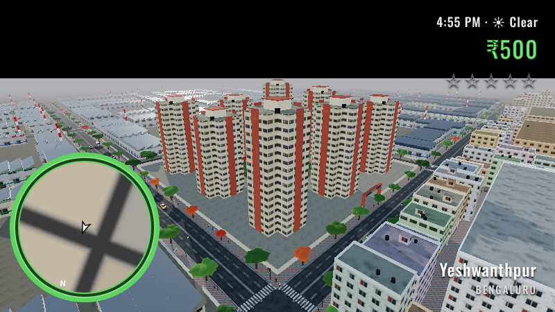
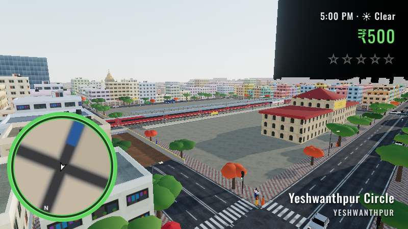
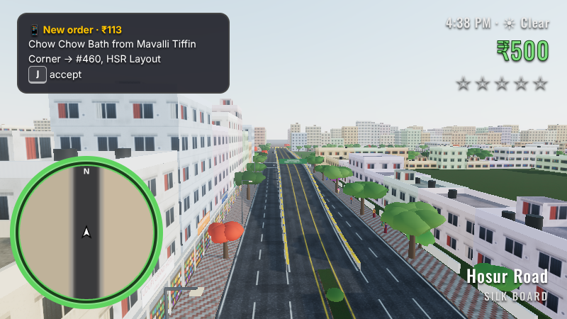
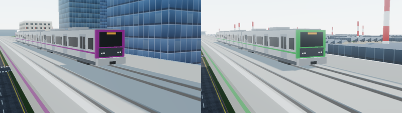
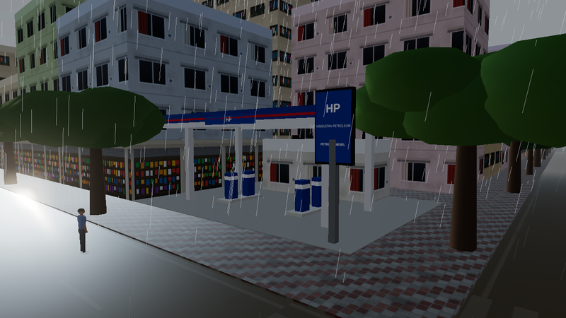

# Namma Bengaluru

An open-world, GTA-style game set in Bengaluru, built for the browser with [Three.js](https://threejs.org).
No downloads and no asset packs: the city, vehicles, people, textures and sound are all generated in code.


| | |
| --- | --- |
|  |  |
| IBC Platinum City on HMT Main Road, Peenya | Yeshwanthpur Junction with an Indian Railways train |
|  |  |
| Hosur Road and the Silk Board flyover | BMTC Ordinary, Vayu Vajra and Vajra buses on MG Road |
|  |  |
| Namma Metro trainsets on the Purple and Green Lines | Real Bengaluru brands: Truffles, Toit and more |
|  | |
| An HP fuel station in a monsoon shower | |

## Play it

```bash
npm install
npm run dev        # open the printed URL (default http://localhost:5173)
```

`npm run build` writes a static site to `dist/` that can be hosted anywhere (GitHub Pages, Netlify, etc.).
On slower machines press **O** for performance mode.

### Controls

| Key | Action |
| --- | --- |
| W A S D / arrows | Walk / drive |
| Mouse | Look around (click the game to capture the mouse) |
| Shift | Run |
| Space | Jump / handbrake |
| Left mouse / Z | Punch |
| Right mouse / X | Kick |
| F (or E) | Get in or out of a vehicle. Works on traffic too ("borrowing") |
| H (or Q) | Horn (every vehicle type sounds different) |
| G | Siren, when you're driving a Hoysala |
| J | Accept the gig on your phone |
| M | City map |
| R | Radio on/off |
| K | Summon (or stop) the monsoon |
| T | Fast-forward time ×30 |
| O | Performance mode |
| Esc | Pause |

## What's in the game

- **The map:** about 3.2 km × 3.2 km, using real road names segment by segment. It covers Peenya, Yeshwanthpur,
  Rajajinagar, Malleshwaram, the CBD, Indiranagar, Lalbagh, Koramangala, Silk Board, HSR and BTM.
- **Landmarks:**
  - **Peenya and Yeshwanthpur:** IBC Platinum City, Yeshwanthpur Junction, ISKCON, World Trade Center Bengaluru at
    Brigade Gateway, Sankey Tank.
  - **CBD:** Vidhana Soudha, the High Court, Cubbon Park with the State Central Library, Chinnaswamy Stadium,
    St. Mark's Cathedral, Ulsoor Lake.
  - **South:** the Lalbagh Glass House, Forum Mall, Central Silk Board, Madiwala Lake.
- **Infrastructure:**
  - The Purple Line metro over MG Road to Indiranagar, and the Green Line along Tumkur Road, with stainless-steel
    trains striped and framed in the line colour.
  - An Indian Railways line through Yeshwanthpur, with every road crossing it running through an underpass.
  - The K.R. Circle and Ejipura underpasses.
  - The **Silk Board flyover** over the Outer Ring Road.
  - About 110 signalised junctions.
- **Vehicles:** 16 types, each with its own horn and engine note:
  - **Two-wheelers:** scooter, delivery scooter, Royal Bullet.
  - **Autos:** auto rickshaw, goods auto.
  - **Cars:** hatchback, sedan, city cab, SUV, and the **Hoysala** (a Maruti Ertiga in the current Bengaluru City
    Police livery: blue swoosh, 112 roundel, ಪೊಲೀಸ್, POLICE on the bonnet; plus a Pink Hoysala variant).
  - **BMTC buses** in five real liveries: blue Ordinary, red Volvo Vajra, teal Vayu Vajra (airport), the white,
    green and blue electric bus, and the orange and blue Metro Feeder, each with an LED route board (500-C SILK
    BOARD, KIA-9 AIRPORT, 335-E MAJESTIC…).
  - **Heavy vehicles:** tempo traveller, Tata Ace-style mini truck, lorry ("Horn OK Please", with a musical horn),
    water tanker, school bus.
- **Traffic:**
  - About 170 vehicles streamed around you, ×1.3 at rush hour.
  - Lorries come out at night (when the city lets them).
  - Cars and buses keep to their lanes. Autos and two-wheelers ignore the lane markings: they weave across the road,
    squeeze through any gap, and now and then ride on the wrong side against the traffic (and get honked at).
  - Signals have red-light jumpers, two-wheelers filter to the front, everyone honks, and cows get right of way.
- **People:**
  - Sarees, kurtas, lungis and office wear.
  - Crowds bunch up at signals and cross on the walk phase, or dash across early.
  - Punch or kick someone and they'll flee, call 112, or occasionally fight back.
- **Police:**
  - A wanted level from 1 to 5 stars.
  - Hoysalas route through the streets to you and ram on sight; constables get out with lathis.
  - Break line of sight to lose them, or get **BUSTED**.
  - Run out of health and you're **WASTED**, and the hospital sends a bill.
- **Day/night and monsoon:**
  - A 24-minute day, with lit windows and shopfronts, sodium street-lamp pools, headlights and bloom.
  - Rain showers come on their own: lightning, thunder, wet reflective roads, underpasses that collect up to a metre
    of brown floodwater, and puddled roads.
  - Traffic slows down and wades through. If you drive into the deep end yourself, your engine may drown (scooters
    first).
- **Brands:** 26 real Bengaluru names on the shopfronts (A2B, MTR, Vidyarthi Bhavan, CTR, Meghana Foods, Truffles,
  Toit, Café Coffee Day, Corner House, Nilgiris, Sapna Book House, Titan, KSIC Mysore Silk, Canara Bank and more),
  many in their home neighbourhoods. Add HP, Indian Oil and Bharat Petroleum fuel stations, the JW Marriott,
  ITC Gardenia and Taj MG Road hotels, and Orion Mall at Brigade Gateway.
- **Gigs:** food deliveries, or auto fares when you drive an auto.

See **[docs/GAME_OUTLINE.md](docs/GAME_OUTLINE.md)** for the game outline: pillars, map, core loop, systems,
art direction and what's next.

## Code tour

```
src/
  config.js            Map: roads (with per-segment names), districts, landmark blocks, metro, railway, underpasses, flyovers
  main.js              Renderer + bloom, game loop, busted/wasted, vehicle-vehicle collisions
  world/
    layout.js          Blocks, junction graph, underpass/flyover geometry, multi-level groundHeight()
    city.js            Footpaths, buildings (incl. Peenya factories), trees with LOD, lamps, night glow
    infrastructure.js  Roads, junctions, medians, underpasses + flood water, Silk Board flyover, railway and trains
    landmarks.js       Procedural landmark models
    metro.js           Purple and Green Line viaducts, stations, trains
    textures.js        Canvas-painted textures (facades, lit windows, asphalt, pavers, signs, water)
    meshBuilder.js     Merged/chunked geometry, per-vertex PBR material, rigid skinning helper
  entities/
    human.js           Skinned 13-bone people + animations (walk, run, sit, punch, kick, lathi, wait…)
    vehicleModels.js   16 vehicle types as single skinned meshes (wheels are bones), decals
    liveries.js        One canvas atlas for every livery: Hoysala, five BMTC liveries, LED route boards
    vehicle.js         Arcade physics, flood drag and stalling, police light bars
    traffic.js         Streaming AI traffic: signals, lane-ignoring autos and bikes, wrong-siders, pooling
    pedestrians.js     Walkers, signal crowds, chai stalls, cows, melee reactions
    player.js          On foot, melee, swimming, vehicles
  systems/
    police.js          Wanted level, Hoysala pursuit AI, constables on foot, busting
    signals.js         Junction signal cycles, signal heads, traffic constables
    environment.js     Day/night, sky, rain, lightning, wetness, flooding, headlights
    audio.js           Synthesised engines, per-type horns, siren, rain, thunder, punches
    missions.js        Gigs, cameraRig.js, colliders.js, input.js
  ui/hud.js            Minimap, health ring, wanted stars, clock/weather, map, busted/wasted screens
```

`window.__game.step(n)` advances the simulation without rendering, which is how the automated checks drive the game.

## Roadmap

The full list is in [docs/GAME_OUTLINE.md](docs/GAME_OUTLINE.md#next-up-proposed). Highlights: vehicle damage,
a phone UI, saving, police roadblocks, more districts (Majestic, KR Market, Whitefield), a glTF art pass for hero
models, and story missions once the outline is settled.
